<div align="center">
  <picture>
    <source media="(prefers-color-scheme: dark)" srcset="docs/assets/logo-dark.svg" />
    <source media="(prefers-color-scheme: light)" srcset="docs/assets/logo-light.svg" />
    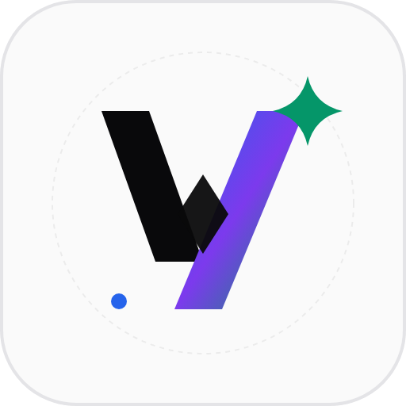
  </picture>

  <h1>Vigilio LLMOps Platform</h1>

  <p>
    <a href="#see-how-it-works">See How It Works</a> ·
    <a href="#dark--light-mode">Dark & Light Mode</a> ·
    <a href="#whats-inside">What's Inside</a> ·
    <a href="#download--get-started">Download & Get Started</a> ·
    <a href="CHANGELOG.md">Changelog (0.1.0-beta)</a>
  </p>

  <p><b>Self-Hosted Enterprise LLMOps Platform: Hexagonal NestJS 11 Core, Preact 11 Reactive SPA, Hybrid RAG (pgvector + FTS RRF <code>k=60</code>), Real-Time FinOps Ledger, Quality Gates & OpenTelemetry.</b></p>
  <p>Deliver production-ready LLM applications with deterministic micro-cent budget enforcement, automated assertion benchmarks, cryptographic release sign-offs, dense + lexical hybrid retrieval, and full data sovereignty — 100% self-hosted on your own infrastructure.</p>

  <p>
    
    
    
    
    
    
  </p>

  <p>
    <a href="#download--get-started"></a>
    <a href="#see-how-it-works"></a>
  </p>

  <p>
    <a href="#download--get-started"><b>Download Vigilio LLMOps 0.1.0-beta</b></a> ·
    <a href="CHANGELOG.md">Release Notes</a> ·
    <a href="docs/GITHUB_RELEASE_0.1.0-beta.md">GitHub Release Guide</a>
  </p>

  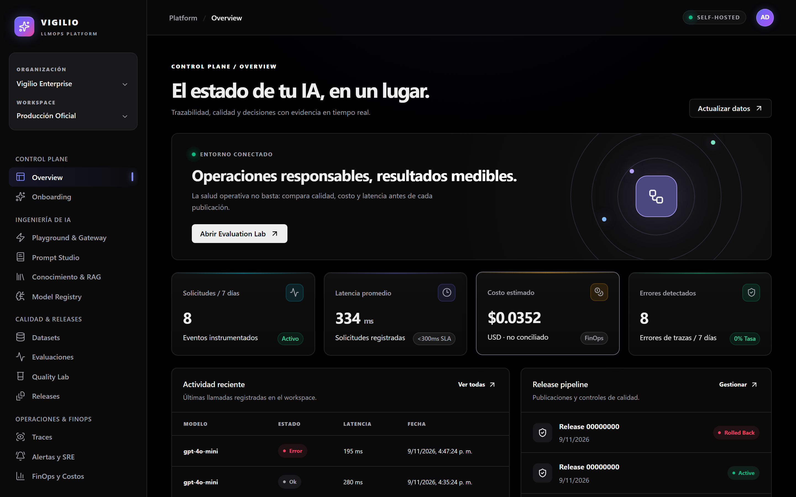
  <p><sub>The Vigilio LLMOps unified control plane: manage active applications, real-time API latency percentiles, FinOps budget consumption, model routes, and quality policies across isolated workspaces.</sub></p>
</div>

> [!NOTE]
> **Complete Data Sovereignty & Zero Cloud Lock-In (`v0.1.0-beta`):** Vigilio LLMOps runs entirely within your company perimeter (Docker Compose, rootless Podman, or bare metal). Your prompt templates, evaluation datasets, vector embeddings, and transactional budget ledgers remain strictly on your premises — with zero external telemetry or SaaS dependency.

---

## The Enterprise Roadblocks We Solve

Deploying LLMs into enterprise production requires far more than wrapping third-party APIs. Organizations face five critical operational roadblocks:

| Enterprise Roadblock | Operational & Business Risk | How Vigilio LLMOps Solves It |
| :--- | :--- | :--- |
| **1. Runaway LLM Costs & Billing Surprises** | Opaque SaaS billing and concurrent API loops cause unexpected thousands of dollars in cloud overages with no preemptive safeguards. | **Micro-Cent FinOps Transactional Ledger:** PostgreSQL hard-budget locking (`SELECT ... FOR UPDATE`) enforces pre-allocation balances before inference. Requests automatically halt or degrade gracefully when hard budget limits are met, eliminating race conditions. |
| **2. Breaking Model Regressions in Production** | Upgrading a model or tweaking a prompt can silently degrade business logic, break JSON schemas, or increase hallucination rates. | **Quality Gates & Benchmark Suites:** Versioned prompt templates must pass deterministic assertion suites and cosine similarity thresholds before being promoted to `production` via cryptographic 4-Eyes sign-off and canary deployments. |
| **3. Low Recall & Hallucinating RAG** | Vector-only semantic search frequently misses precise keyword matches (part numbers, error codes, legal clauses), while keyword search misses semantic context. | **Hybrid RAG with Reciprocal Rank Fusion (`RRF k=60`):** Combines dense vector similarity (`pgvector` with HNSW indexing) and PostgreSQL full-text search (`ts_rank_cd`), reinforced with document-level Access Control Lists (ACL). |
| **4. Black-Box Inferences & Missing Traceability** | Debugging complex chains or tool invocations in production is impossible when logs are scattered or lack span-level cost attribution. | **Native OpenTelemetry Spans & Distributed Traces:** Complete waterfall visualization across gateway handlers, model calls, vector retrieval, and token usage, exported to Prometheus, Grafana, and Loki. |
| **5. Compliance, Security & Data Exfiltration** | Sending enterprise documents to multi-tenant external clouds violates SOC 2, HIPAA, and ISO 27001 requirements. | **100% Self-Hosted & Cryptographically Verified:** Packaged with Ansible hardening, rootless Podman execution, `cosign verify` image attestation, and immutable SHA-256 audit chaining. |

---

## See How It Works

Short interactive recordings captured live from the running **Vigilio LLMOps `0.1.0-beta`** platform:

### 1. Interactive Playground & Prompt Studio

Navigate to **Prompt Studio** to inspect immutable versioned templates, launch the **Playground & Gateway**, test prompt variables with live streaming inference, and observe real-time token consumption and latency metrics.

<div align="center">
  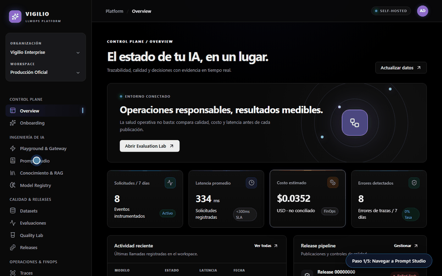
  <p><sub>🎬 Auto-playing preview · <a href="docs/assets/videos/01-playground-and-prompts.webm">Open full-resolution video (WebM)</a></sub></p>
</div>

### 2. Evaluation Benchmark Suites & Quality Gate Releases

Run comprehensive test suites in the **Evaluation Lab**, audit pass rates (such as *96% Accuracy* on the Customer Triage Benchmark), inspect individual assertions, and verify that releases pass the strict **Quality Gate** policy before deployment.

<div align="center">
  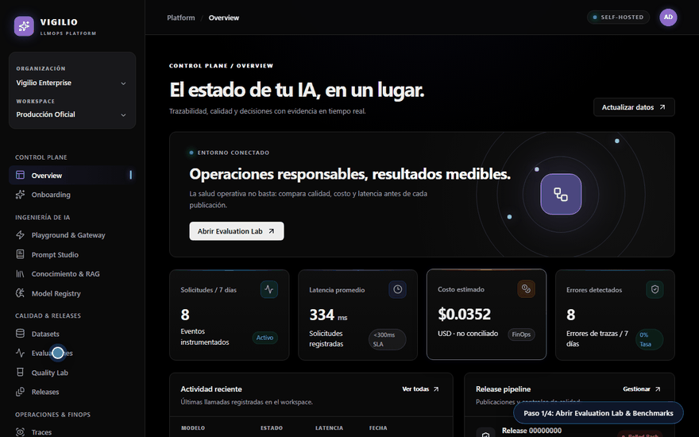
  <p><sub>🎬 Auto-playing preview · <a href="docs/assets/videos/02-evaluations-and-releases.webm">Open full-resolution video (WebM)</a></sub></p>
</div>

### 3. Hybrid RAG Search & Dark/Light Mode Theme Toggle

Search internal company runbooks using **Hybrid RAG** (combining `pgvector` dense search with full-text search), verify source citations, and toggle seamlessly between **Dark Mode** and **Light Mode** directly from the sidebar.

<div align="center">
  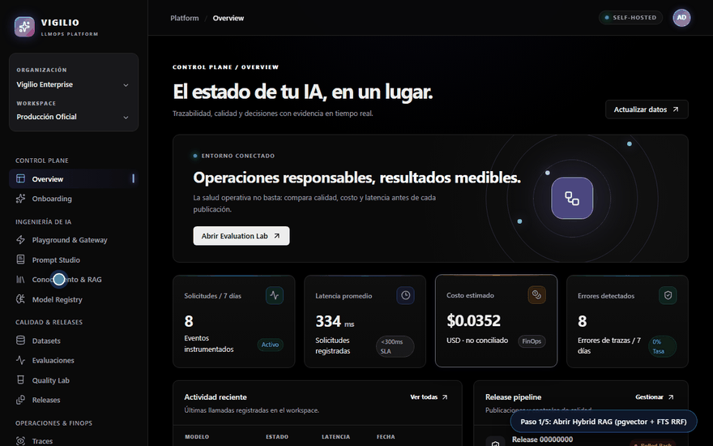
  <p><sub>🎬 Auto-playing preview · <a href="docs/assets/videos/03-hybrid-rag-and-theme-toggle.webm">Open full-resolution video (WebM)</a></sub></p>
</div>

---

## Dark & Light Mode

Switch comfortably between Dark Mode and Light Mode at any time using the theme switcher in the navigation sidebar — the entire console and brand assets adapt instantly with full WCAG 2.2 AA contrast compliance.

| Dark Mode | Light Mode |
| :---: | :---: |
|  | 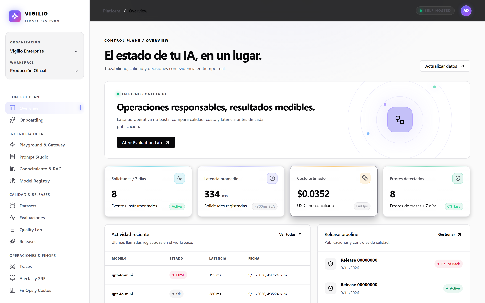 |
| <sub>Primary Control Plane in Dark Mode, engineered for developer focus, high contrast, and reduced eye strain during extended operational shifts.</sub> | <sub>The exact same operational dashboard rendered in clean Light Mode for bright office environments and formal executive reporting.</sub> |

---

## What's Inside

<table>
  <tr>
    <td width="50%">
      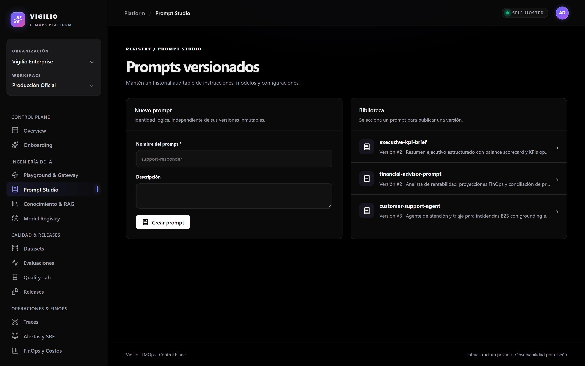
      <p align="center"><sub><b>Prompt Studio & Semantic Versioning:</b> Maintain immutable version histories (<code>v1</code>, <code>v2</code>), define Jinja/Handlebars variables, and compare visual diffs between revisions.</sub></p>
    </td>
    <td width="50%">
      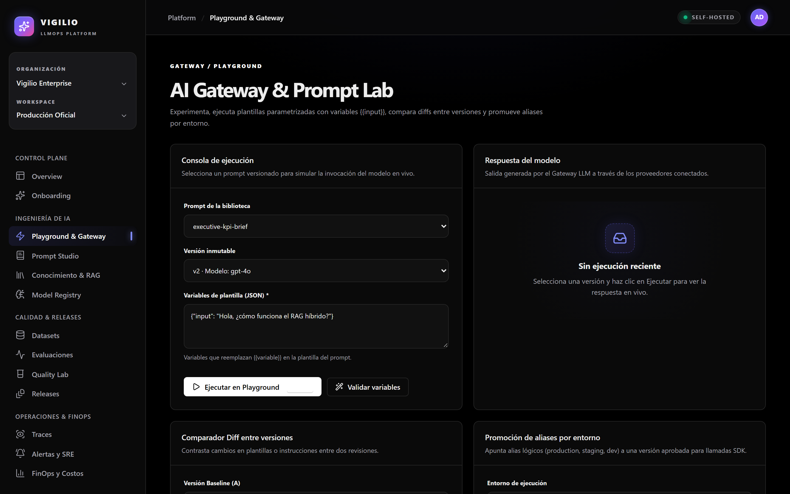
      <p align="center"><sub><b>Interactive Playground:</b> Test prompts against local or remote models, simulate production parameters, and inspect token generation alongside exact latency.</sub></p>
    </td>
  </tr>
  <tr>
    <td width="50%">
      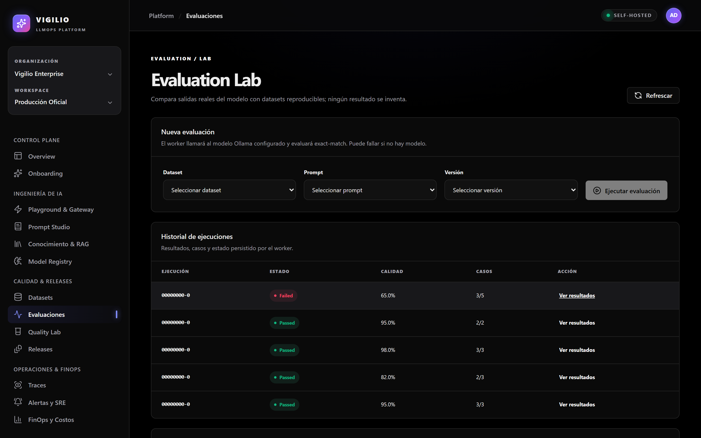
      <p align="center"><sub><b>Deterministic Evaluation Lab:</b> Execute reproducible test suites against golden datasets with exact-match and semantic cosine assertions to prevent regressions.</sub></p>
    </td>
    <td width="50%">
      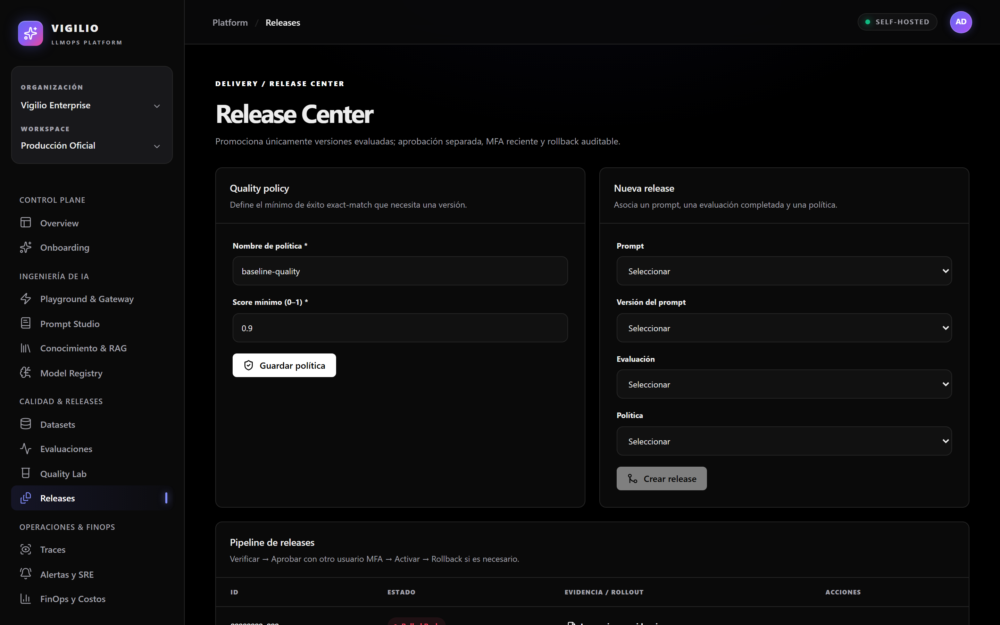
      <p align="center"><sub><b>Cryptographic Release Gates:</b> Enforce quality policies (score ≥ 0.90) and four-eyes authorization before promoting candidates to production environments.</sub></p>
    </td>
  </tr>
  <tr>
    <td width="50%">
      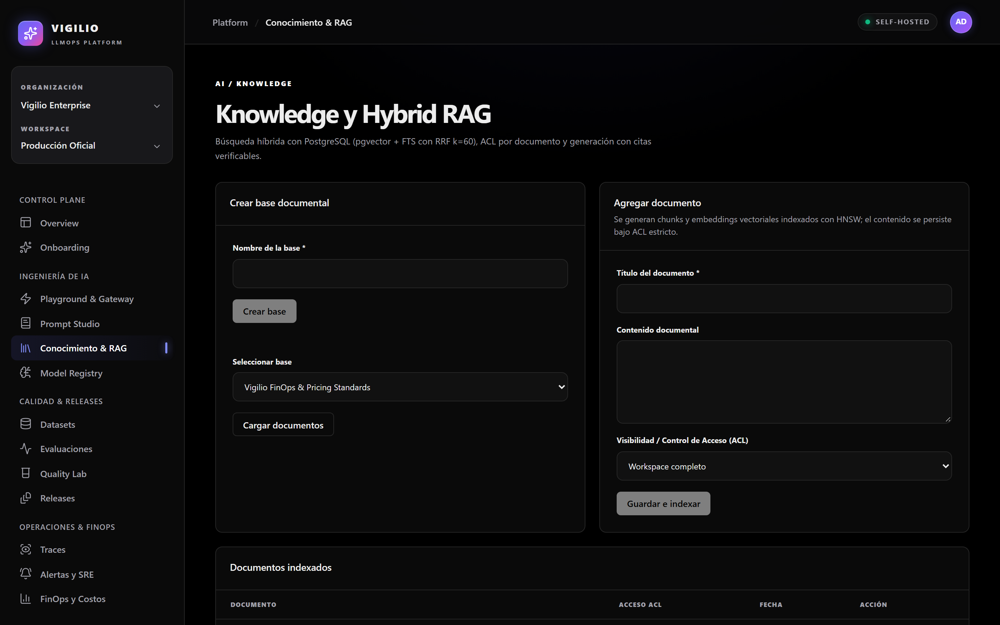
      <p align="center"><sub><b>Private Hybrid RAG:</b> Index company runbooks into dense vectors and lexically indexed chunks with strict document-level ACLs and verifiable citations.</sub></p>
    </td>
    <td width="50%">
      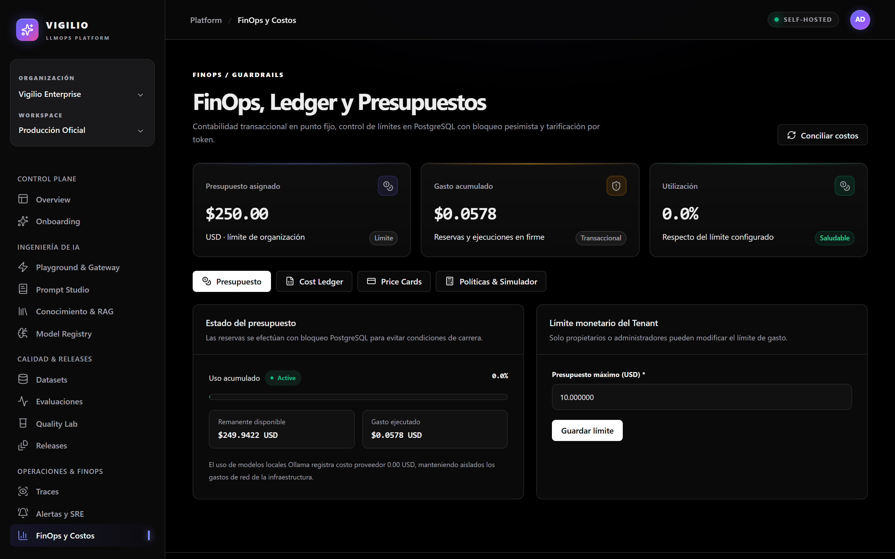
      <p align="center"><sub><b>Micro-Cent FinOps Ledger:</b> Monitor real-time spending with transactional precision, enforce hard limits per workspace, and track cost breakdown by model.</sub></p>
    </td>
  </tr>
  <tr>
    <td width="50%">
      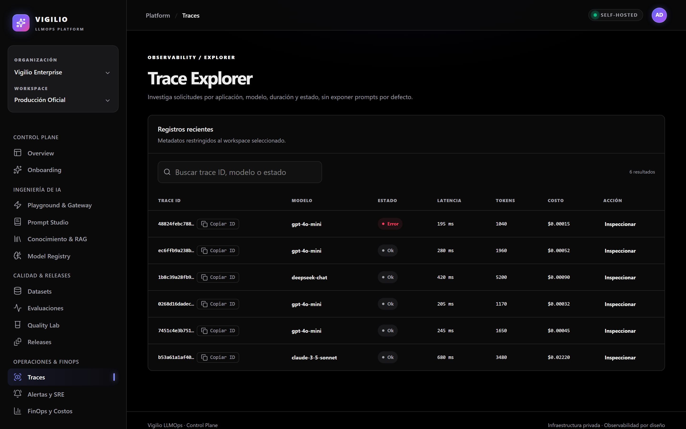
      <p align="center"><sub><b>OpenTelemetry Traces & Spans:</b> Inspect distributed waterfalls across prompt compilation, gateway routing, vector retrieval, and LLM inference.</sub></p>
    </td>
    <td width="50%">
      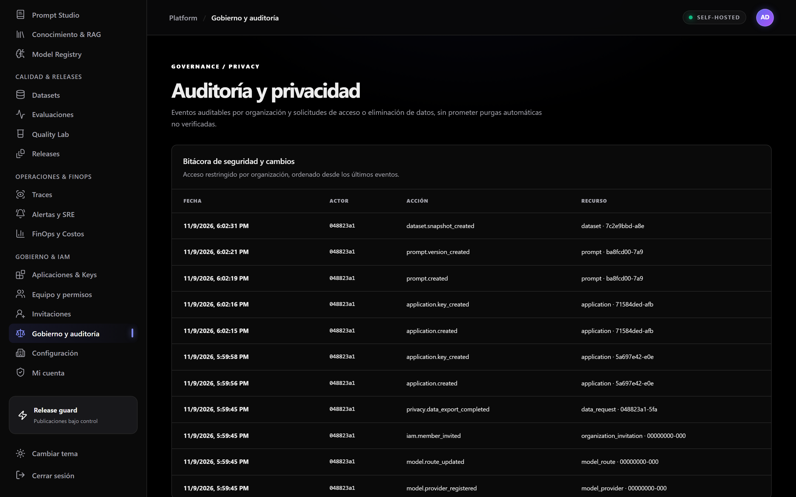
      <p align="center"><sub><b>Immutable Audit & IAM:</b> Track workspace modifications, access requests, and release approvals with tamper-evident SHA-256 audit chaining.</sub></p>
    </td>
  </tr>
  <tr>
    <td colspan="2">
      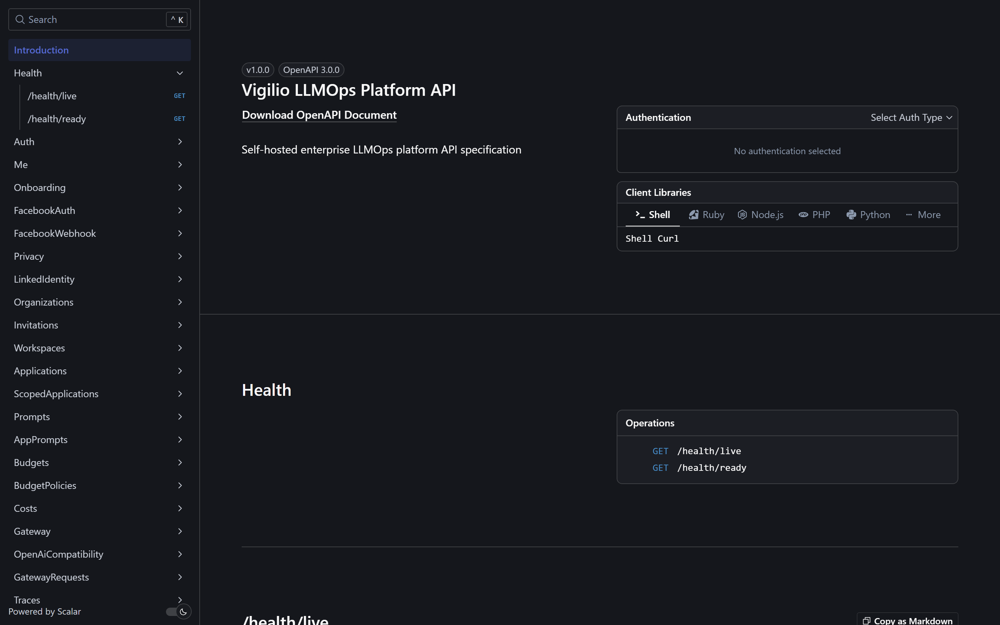
      <p align="center"><sub><b>Built-In Scalar API Reference:</b> Explore and test all Vigilio LLMOps REST endpoints interactively directly from your browser at <code>/reference</code>.</sub></p>
    </td>
  </tr>
</table>

---

## Download & Get Started

**Current Version:** `0.1.0-beta` ([Read the Changelog](CHANGELOG.md))

### Step 1 — Download or Clone the Platform

Choose whichever workflow fits your operational pipeline:

- **Option A — Clone with Git:**
  ```bash
  git clone https://github.com/VigilioYonatan/vigilio-llmops-platform.git
  cd vigilio-llmops-platform
  ```
- **Option B — Download Release:**
  Download **`vigilio-llmops-platform-v0.1.0-beta.zip`** from the GitHub Releases page.

### Step 2 — Start the Enterprise Stack

Ensure [Docker](https://www.docker.com/) (or rootless [Podman](https://podman.io/)) is running, then launch the stack:

```bash
# Start all core services (PostgreSQL 16 + pgvector, Valkey, NATS, Caddy, API & Web)
docker compose -f vigilio-llmops-deploy/compose/compose.yaml up -d
```

Once initialized, open your browser:

- **Vigilio Web Console:** `http://localhost:5174` (or port configured in Caddy)
- **Interactive Scalar API Docs:** `http://localhost:3001/reference`
- **Default Seed Credentials:**
  - Email: `admin@vigilio.io` (or `dev@vigilio.io`)
  - Password: `Password123!` *(leave MFA empty for admin)*

---

<details>
<summary><b>🛠️ For Developers & Deep Engineering Architecture</b></summary>

<br />

### Workspace Topology (5 Coordinated Repositories)

The platform is engineered across 5 decoupled repositories following strict checkout governance:

```text
vigilio-llmops-platform/
├── apps/
│   ├── vigilio-llmops-impl/      # Hexagonal Backend (NestJS 11, Drizzle ORM, pgvector, Valkey, NATS, FinOps)
│   └── vigilio-llmops-web/       # Reactive Web Console (Preact 11, Signals, TanStack Query, Zod 'es')
├── vigilio-llmops-deploy/        # Docker Compose topology, Caddyfile, OTel/Prometheus/Grafana, pgBackRest PITR
├── platform-ops/                 # Idempotent Ansible roles (hardening, rootless Podman, cosign_verify)
├── prod-local/                   # Local staging lab & operational validation harness
├── docs/assets/                  # Vector Dark/Light logos, 2x Retina screenshots & recorded demo videos
├── scripts/                      # Quality gates, E2E Playwright suites & automated showcase recorders
├── CHANGELOG.md                  # Semantic release history (0.1.0-beta)
└── VERSION                       # Canonical version file (0.1.0-beta)
```

### Hexagonal Architecture & Ports/Adapters

The core backend implements pragmatic Domain-Driven Design (DDD) with clear boundary separation:

```text
                    [ HTTP REST / OpenAPI / Scalar ]
                                   │
                                   ▼
               ┌───────────────────────────────────────┐
               │         Inbound Ports (HTTP)          │
               ├───────────────────────────────────────┤
               │          Application Services         │
               │   (Prompts, Evals, FinOps, RAG)       │
               ├───────────────────────────────────────┤
               │          Domain Entities &            │
               │     Invariants (Strict Ledger)        │
               ├───────────────────────────────────────┤
               │         Outbound Ports (SPI)          │
               └───────────────────────────────────────┘
                                   │
         ┌─────────────────────────┼─────────────────────────┐
         ▼                         ▼                         ▼
[ PostgreSQL + pgvector ]     [ Valkey Cache ]     [ NATS JetStream Events ]
```

### Micro-Cent FinOps Mathematical Model

To guarantee financial non-repudiation, all token consumption is calculated using high-precision decimal arithmetic and locked against race conditions:

$$\text{Total Cost} = (\text{Input Tokens} \times \text{Rate}_{\text{input}}) + (\text{Output Tokens} \times \text{Rate}_{\text{output}})$$

A strict database transaction checks:

$$\text{Spent}_{\text{current}} + \text{Cost}_{\text{estimated}} \le \text{Budget}_{\text{hard\_limit}}$$

If exceeded, the transaction rolls back immediately with code `BUDGET_EXCEEDED`, preventing any unbilled execution.

### Hybrid RAG Reciprocal Rank Fusion Formula

Document chunks are ranked using reciprocal rank fusion ($k = 60$) over semantic dense vectors and BM25 lexical full-text search:

$$\text{RRF\_Score}(d) = \sum_{m \in \{\text{vector}, \text{lexical}\}} \frac{1}{k + \text{rank}_m(d)}$$

### Automated Verification & Quality Gates

Run the automated suites from the repository root:

```bash
# 1. Run full PostgreSQL + Playwright Master E2E Suite (66/66 tables validated)
node scripts/test-master-e2e.mjs

# 2. Run clean super seed replenishment
node --env-file=apps/vigilio-llmops-impl/.env apps/vigilio-llmops-impl/node_modules/tsx/dist/cli.mjs apps/vigilio-llmops-impl/scripts/seed-super.ts

# 3. Refresh screenshots & demo recordings from live application
node scripts/capture_readme_showcase.cjs
```

</details>

---

## Frequently Asked Questions

| Question | Answer |
| :--- | :--- |
| **Can I run this completely offline / air-gapped?** | Yes. Vigilio LLMOps can connect to local models (e.g. via Ollama or vLLM) and uses PostgreSQL 16 with `pgvector` locally, requiring zero external internet access. |
| **How does FinOps prevent budget overruns?** | Unlike SaaS platforms that report usage after the fact, Vigilio LLMOps performs transactional pre-flight checks using `SELECT ... FOR UPDATE` row locks to halt requests before credit is overdrawn. |
| **Can I toggle between Dark Mode and Light Mode?** | Yes! Simply click the "Cambiar tema" button in the navigation sidebar at any time. Both themes are fully responsive and meet WCAG 2.2 AA standards. |
| **Is the API compatible with OpenAI SDKs?** | Yes. In addition to the comprehensive `/api/v1` endpoints, Vigilio LLMOps includes an OpenAI-compatible gateway route at `/v1/chat/completions`. |

---

## Governance & License

- **Author & Lead Architect:** Yonatan Vigilio (`yonatanvigiliolavado@gmail.com`)
- **License:** Distributed under the [MIT License](LICENSE).
- **Security & Vulnerability Reporting:** Please consult our security policy before reporting vulnerabilities.
